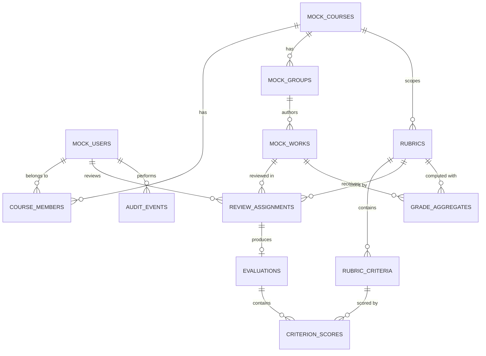

<!-- AI_USAGE_LOG -->
## AI Usage Log

| Item | Value |
|---|---|
| AI tool | Claude (Anthropic) autonomous developer agent, Claude Code / Agent SDK harness. See `Agent_environment.md` |
| Model | `claude-opus-5-5` (Claude Opus 5.5) |
| Conceptual AI contribution | **100% AI generated / 0% human** |
| What the AI did | Wrote the whole specification (endpoints, schemas, data model, mock data) from the course project description and the student prompts. |
| Chat link | https://claude.ai/code/session_01Mj79JKPdEzVKaYZjwhQedg |
| Chat export (appendix) | [`ai-chat-export/chat-transcript.md`](ai-chat-export/chat-transcript.md) |

### Exact student prompts (8), copied verbatim from the session transcript

Copied by script from the exported transcript, unedited, typos included. Text written by the AI is never listed here as a student prompt.

**Prompt 1** (2026-11-02 22:56 ET)

~~~~text
I'm doing Project Assignment 1 for CS763 Secure Software Development at BU MET. I'll attach the project description document in a folder that you have access to.

My service: ["The Peer Review & Evaluation Gateway"]
My tech stack: [Node.js/TypeScript]

Please read the entire project outline first, then build ONLY the PA1 deliverables, nothing extra:
spec.md (REST endpoints, JSON schemas, database models, static mock data)
Agent_environment.md (document yourself as my AI developer agent: tools, mode, model, settings, host environment)
Prompt_test_log.md (my prompts + the code you generated)
.github/workflows/devsecops.yml (builds Docker, Trivy dependency + image scan, Semgrep, SonarQube Cloud; all scans non-blocking)
A multi-stage Dockerfile + docker-compose.yml (app + its own database) running a barebones app
A verified pipeline run log saved in the repo
Then a GitHub release tagged "project-assignment-1" and a short summary I can paste into Blackboard

Follow the AI logging rules in the document exactly:
Every code/config file gets the header "AI Contribution Weight: [X%] AI Generated / [Y%] Human Refactored" with honest numbers (if I don't edit the code, it's 100/0)
Keep a code_AI_history.md logging every AI interaction, and include an export of our chat
Label commits "AI AGENT BUILD: <feature>" (or "HUMAN MOD: <feature>" if I edit something by hand)
Every markdown file starts with an AI Usage Log showing the AI contribution % and my EXACT prompts, word for word with typos included
Never label text you wrote yourself as my prompt

Things I'll do myself when you ask: I have the repo already and GitHub is connected, sign in to SonarCloud, and add the SONAR_TOKEN secret. Open the pages for me and tell me what to click.

Once it's done, check every rule in the document again before telling me to publish the release.
~~~~

**Prompt 2** (2026-11-02 23:14 ET)

~~~~text
i have my github open within the browser
~~~~

**Prompt 3** (2026-11-02 23:18 ET)

~~~~text
check if github is set up now
~~~~

**Prompt 4** (2026-11-02 23:19 ET)

~~~~text
done
~~~~

**Prompt 5** (2026-11-02 23:22 ET)

~~~~text
sonar is open
~~~~

**Prompt 6** (2026-11-02 23:24 ET)

~~~~text
onboarding is open
~~~~

**Prompt 7** (2026-11-02 23:25 ET)

~~~~text
i never copied anything from sonar
~~~~

**Prompt 8** (2026-11-02 23:26 ET)

~~~~text
done adding secret into github
~~~~

---
<!-- /AI_USAGE_LOG -->
# spec.md — Peer Review & Evaluation Gateway

**Project Portal (PP) — Domain 3** · CS763 Secure Software Development · Project Assignment 1
**Stack:** Node.js 22 + TypeScript, Express 5, PostgreSQL 17, Docker / Docker Compose

---

## 1. Purpose and scope

The Peer Review & Evaluation Gateway (PREG) runs the formal academic grading matrix of the Project Portal. Faculty, course instructors and student peers use it to:

1. author structured **evaluation rubrics** (weighted criteria with point scales) for a course;
2. **assign reviewers** (instructors and student peers) to published works;
3. **submit evaluations**: one score per rubric criterion plus comments;
4. **aggregate** submitted evaluations into a final grade per work, and let an instructor finalize or override and then publish it;
5. keep an **audit trail** of every grading action.

**Boundaries (per the project rules):**

- The service is isolated. It talks only to its own single-tenant PostgreSQL database.
- It never calls the other PP services. Data that belongs elsewhere (users from campus identity, courses and groups, published works from the Domain 1 Artifact Indexer) is provided as **local static mock data** (§7) and treated as read-only reference data.
- Authentication mechanics (token issuance and verification) are outside this functional spec. The API assumes every request carries an identified **actor** (`actorId`, `role`). In local development the actor is one of the mock users in §7.1. PA3 replaces this with JWT verification.

### 1.1 Roles

| Role | Description |
|---|---|
| `FACULTY` | Course owner. Full control of rubrics, assignments and grades in their courses. |
| `INSTRUCTOR` | Course staff (co-instructor / TA). Can manage assignments, evaluate, aggregate. Cannot delete rubrics or publish grades unless also `FACULTY`. |
| `STUDENT` | Peer reviewer. Can see only their own assignments and evaluations, and the published grade of works they authored. |

### 1.2 Core workflow


---

## 2. API conventions

| Item | Convention |
|---|---|
| Base path | `/api/v1` |
| Format | `application/json; charset=utf-8` for request and response bodies |
| IDs | UUID v4 strings |
| Timestamps | ISO-8601 UTC strings (`2026-11-02T18:00:00Z`) |
| Field naming | `camelCase` in JSON, `snake_case` in the database |
| Pagination | `?limit=` (1–100, default 20) and `?offset=` (default 0). List responses: `{ "data": [...], "page": { "limit", "offset", "total" } }` |
| Optimistic concurrency | Mutable resources carry `version` (integer). `PATCH`/`PUT` must send the current `version`; a mismatch returns `409 CONFLICT` |
| Errors | Always the `Error` schema (§4.1) |

### 2.1 Status codes

| Code | Used when |
|---|---|
| `200` | Successful read/update |
| `201` | Resource created (`Location` header set) |
| `204` | Successful delete |
| `400` | `VALIDATION_ERROR`: body or query fails its schema |
| `401` | `UNAUTHENTICATED`: no actor identified |
| `403` | `FORBIDDEN`: actor's role or course membership does not allow the action |
| `404` | `NOT_FOUND`: resource does not exist or is not visible to the actor |
| `409` | `CONFLICT`: version mismatch, or illegal state transition (e.g. editing a published rubric) |
| `422` | `BUSINESS_RULE_VIOLATION`: e.g. criterion weights do not sum to 100, score above `maxPoints` |
| `500` | `INTERNAL_ERROR`: no internal details are returned |

---

## 3. REST endpoints

### 3.1 Service

| Method | Path | Description | Roles |
|---|---|---|---|
| GET | `/health` | Liveness probe: `{ "status": "ok", "service": "peer-review-evaluation-gateway" }` | public |
| GET | `/health/ready` | Readiness probe; checks DB. `200 {status:"ready",database:"up"}` or `503` | public |
| GET | `/api/v1` | Service descriptor (name, domain, version) | public |

> Only the three endpoints above are implemented in the PA1 barebones app. Everything below is specified for later phases.

### 3.2 Reference data (read-only, served from static mock data)

| Method | Path | Description | Roles |
|---|---|---|---|
| GET | `/api/v1/me` | Current actor profile and course memberships | all |
| GET | `/api/v1/courses` | Courses the actor belongs to | all |
| GET | `/api/v1/courses/{courseId}` | One course with its project groups | members |
| GET | `/api/v1/works?courseId=&groupId=` | Published works (mock of Domain 1 artifacts) | members |
| GET | `/api/v1/works/{workId}` | One work | members |

### 3.3 Rubrics and criteria

| Method | Path | Body | Success | Roles |
|---|---|---|---|---|
| POST | `/api/v1/rubrics` | `RubricCreate` | `201 Rubric` (status `DRAFT`) | FACULTY |
| GET | `/api/v1/rubrics?courseId=&status=` | – | `200 List<Rubric>` | FACULTY, INSTRUCTOR; STUDENT sees only `PUBLISHED` rubrics of their assignments |
| GET | `/api/v1/rubrics/{rubricId}` | – | `200 Rubric` (with `criteria[]`) | as above |
| PATCH | `/api/v1/rubrics/{rubricId}` | `RubricUpdate` | `200 Rubric` | FACULTY; `DRAFT` only, else `409` |
| DELETE | `/api/v1/rubrics/{rubricId}` | – | `204` | FACULTY; `DRAFT` only |
| POST | `/api/v1/rubrics/{rubricId}/criteria` | `CriterionCreate` | `201 Criterion` | FACULTY; `DRAFT` only |
| PATCH | `/api/v1/rubrics/{rubricId}/criteria/{criterionId}` | `CriterionUpdate` | `200 Criterion` | FACULTY; `DRAFT` only |
| DELETE | `/api/v1/rubrics/{rubricId}/criteria/{criterionId}` | – | `204` | FACULTY; `DRAFT` only |
| POST | `/api/v1/rubrics/{rubricId}/publish` | `{ "version": n }` | `200 Rubric` (`PUBLISHED`) | FACULTY; needs ≥1 criterion and weights summing to 100, else `422` |
| POST | `/api/v1/rubrics/{rubricId}/archive` | `{ "version": n }` | `200 Rubric` (`ARCHIVED`) | FACULTY |

A rubric is immutable once `PUBLISHED`. To change it, create a new rubric; `parentRubricId` links the revision.

### 3.4 Review assignments

| Method | Path | Body | Success | Roles |
|---|---|---|---|---|
| POST | `/api/v1/assignments` | `AssignmentCreate` (one or a batch of up to 200) | `201 { "data": [Assignment] }` | FACULTY, INSTRUCTOR |
| GET | `/api/v1/assignments?rubricId=&workId=&reviewerId=&status=` | – | `200 List<Assignment>` | FACULTY, INSTRUCTOR (course); STUDENT: own only |
| GET | `/api/v1/assignments/{assignmentId}` | – | `200 Assignment` | staff, or the assigned reviewer |
| PATCH | `/api/v1/assignments/{assignmentId}` | `AssignmentUpdate` (`dueAt`, `status: WITHDRAWN`) | `200 Assignment` | FACULTY, INSTRUCTOR |

Rules: the rubric must be `PUBLISHED`; the reviewer must be a member of the work's course; a student cannot review a work authored by their own group (`422 SELF_REVIEW`); `(rubricId, workId, reviewerId)` is unique.

### 3.5 Evaluations and scores

| Method | Path | Body | Success | Roles |
|---|---|---|---|---|
| POST | `/api/v1/assignments/{assignmentId}/evaluation` | `{}` | `201 Evaluation` (`DRAFT`); `409` if one already exists | assigned reviewer |
| GET | `/api/v1/evaluations/{evaluationId}` | – | `200 Evaluation` (with `scores[]`) | reviewer; staff of course |
| PUT | `/api/v1/evaluations/{evaluationId}/scores` | `ScoresUpsert` | `200 Evaluation` | reviewer; `DRAFT` only |
| PATCH | `/api/v1/evaluations/{evaluationId}` | `EvaluationUpdate` (`overallComment`) | `200 Evaluation` | reviewer; `DRAFT` only |
| POST | `/api/v1/evaluations/{evaluationId}/submit` | `{ "version": n }` | `200 Evaluation` (`SUBMITTED`) | reviewer; every criterion scored, else `422`; after `dueAt` → `409 PAST_DUE` |
| GET | `/api/v1/works/{workId}/evaluations` | – | `200 List<Evaluation>` | FACULTY, INSTRUCTOR. With `anonymity = DOUBLE_BLIND` the reviewer identity is masked for INSTRUCTOR |

`totalScore` is computed by the server (§5) and never accepted from the client.

### 3.6 Grade aggregation

| Method | Path | Body | Success | Roles |
|---|---|---|---|---|
| POST | `/api/v1/works/{workId}/grades/{rubricId}/compute` | – | `200 GradeAggregate` (`COMPUTED`) | FACULTY, INSTRUCTOR |
| GET | `/api/v1/works/{workId}/grades/{rubricId}` | – | `200 GradeAggregate` | staff; work authors only after `PUBLISHED` |
| PATCH | `/api/v1/works/{workId}/grades/{rubricId}` | `GradeOverride` | `200 GradeAggregate` (`FINALIZED`) | FACULTY, INSTRUCTOR; `overrideReason` required |
| POST | `/api/v1/works/{workId}/grades/{rubricId}/publish` | `{ "version": n }` | `200 GradeAggregate` (`PUBLISHED`) | FACULTY |

### 3.7 Audit trail

| Method | Path | Description | Roles |
|---|---|---|---|
| GET | `/api/v1/audit-events?entityType=&entityId=&actorId=&from=&to=` | Append-only log of state changes (create, update, submit, compute, override, publish) | FACULTY |

---

## 4. JSON schemas (JSON Schema 2020-12)

Shared definitions:

```json
{
  "$id": "https://preg.local/schemas/common.json",
  "$defs": {
    "uuid": { "type": "string", "format": "uuid" },
    "timestamp": { "type": "string", "format": "date-time" },
    "version": { "type": "integer", "minimum": 1 },
    "shortText": { "type": "string", "minLength": 1, "maxLength": 200 },
    "longText": { "type": "string", "maxLength": 5000 }
  }
}
```

### 4.1 Error

```json
{
  "$id": "Error",
  "type": "object",
  "required": ["error"],
  "properties": {
    "error": {
      "type": "object",
      "required": ["code", "message"],
      "properties": {
        "code": { "type": "string", "enum": ["VALIDATION_ERROR", "UNAUTHENTICATED", "FORBIDDEN", "NOT_FOUND", "CONFLICT", "PAST_DUE", "SELF_REVIEW", "BUSINESS_RULE_VIOLATION", "INTERNAL_ERROR"] },
        "message": { "type": "string" },
        "details": { "type": "array", "items": { "type": "object", "properties": { "field": { "type": "string" }, "issue": { "type": "string" } } } }
      },
      "additionalProperties": false
    }
  }
}
```

### 4.2 Rubric

```json
{
  "$id": "RubricCreate",
  "type": "object",
  "required": ["courseId", "title", "scaleType"],
  "additionalProperties": false,
  "properties": {
    "courseId": { "$ref": "common.json#/$defs/uuid" },
    "title": { "$ref": "common.json#/$defs/shortText" },
    "description": { "$ref": "common.json#/$defs/longText" },
    "scaleType": { "type": "string", "enum": ["POINTS", "PERCENT", "LIKERT_5"] },
    "peerWeight": { "type": "integer", "minimum": 0, "maximum": 100, "default": 30, "description": "Share (%) of the final grade that comes from student peer evaluations; the remainder comes from instructor evaluations." },
    "anonymity": { "type": "string", "enum": ["OPEN", "SINGLE_BLIND", "DOUBLE_BLIND"], "default": "SINGLE_BLIND" },
    "parentRubricId": { "$ref": "common.json#/$defs/uuid" }
  }
}
```

`RubricUpdate` has the same properties, all optional, plus `"version"` (required). `courseId` cannot change.

```json
{
  "$id": "Rubric",
  "type": "object",
  "required": ["id", "courseId", "title", "scaleType", "peerWeight", "anonymity", "status", "createdBy", "version", "createdAt", "updatedAt", "criteria"],
  "properties": {
    "id": { "$ref": "common.json#/$defs/uuid" },
    "courseId": { "$ref": "common.json#/$defs/uuid" },
    "title": { "type": "string" },
    "description": { "type": "string" },
    "scaleType": { "type": "string", "enum": ["POINTS", "PERCENT", "LIKERT_5"] },
    "peerWeight": { "type": "integer" },
    "anonymity": { "type": "string", "enum": ["OPEN", "SINGLE_BLIND", "DOUBLE_BLIND"] },
    "status": { "type": "string", "enum": ["DRAFT", "PUBLISHED", "ARCHIVED"] },
    "parentRubricId": { "type": ["string", "null"], "format": "uuid" },
    "createdBy": { "$ref": "common.json#/$defs/uuid" },
    "publishedAt": { "type": ["string", "null"], "format": "date-time" },
    "version": { "$ref": "common.json#/$defs/version" },
    "createdAt": { "$ref": "common.json#/$defs/timestamp" },
    "updatedAt": { "$ref": "common.json#/$defs/timestamp" },
    "criteria": { "type": "array", "items": { "$ref": "Criterion" } }
  }
}
```

### 4.3 Criterion

```json
{
  "$id": "CriterionCreate",
  "type": "object",
  "required": ["title", "weight", "maxPoints"],
  "additionalProperties": false,
  "properties": {
    "title": { "$ref": "common.json#/$defs/shortText" },
    "description": { "$ref": "common.json#/$defs/longText" },
    "weight": { "type": "integer", "minimum": 1, "maximum": 100, "description": "Percent of the rubric total; all criteria of a rubric must sum to 100 before publishing." },
    "maxPoints": { "type": "number", "exclusiveMinimum": 0, "maximum": 1000 },
    "position": { "type": "integer", "minimum": 0 },
    "levels": {
      "type": "array", "maxItems": 10,
      "items": { "type": "object", "required": ["label", "points"], "additionalProperties": false,
        "properties": { "label": { "$ref": "common.json#/$defs/shortText" }, "points": { "type": "number", "minimum": 0 }, "descriptor": { "$ref": "common.json#/$defs/longText" } } }
    }
  }
}
```

`Criterion` = `CriterionCreate` + `id`, `rubricId`, `version`, `createdAt`, `updatedAt`. `CriterionUpdate` = all optional + required `version`.

### 4.4 Assignment

```json
{
  "$id": "AssignmentCreate",
  "type": "object",
  "required": ["assignments"],
  "additionalProperties": false,
  "properties": {
    "assignments": {
      "type": "array", "minItems": 1, "maxItems": 200,
      "items": {
        "type": "object",
        "required": ["rubricId", "workId", "reviewerId", "dueAt"],
        "additionalProperties": false,
        "properties": {
          "rubricId": { "$ref": "common.json#/$defs/uuid" },
          "workId": { "$ref": "common.json#/$defs/uuid" },
          "reviewerId": { "$ref": "common.json#/$defs/uuid" },
          "dueAt": { "$ref": "common.json#/$defs/timestamp" }
        }
      }
    }
  }
}
```

```json
{
  "$id": "Assignment",
  "type": "object",
  "required": ["id", "rubricId", "workId", "reviewerId", "reviewerRole", "assignedBy", "status", "dueAt", "version", "createdAt", "updatedAt"],
  "properties": {
    "id": { "$ref": "common.json#/$defs/uuid" },
    "rubricId": { "$ref": "common.json#/$defs/uuid" },
    "workId": { "$ref": "common.json#/$defs/uuid" },
    "reviewerId": { "$ref": "common.json#/$defs/uuid" },
    "reviewerRole": { "type": "string", "enum": ["FACULTY", "INSTRUCTOR", "STUDENT"] },
    "assignedBy": { "$ref": "common.json#/$defs/uuid" },
    "status": { "type": "string", "enum": ["ASSIGNED", "IN_PROGRESS", "SUBMITTED", "WITHDRAWN"] },
    "dueAt": { "$ref": "common.json#/$defs/timestamp" },
    "evaluationId": { "type": ["string", "null"], "format": "uuid" },
    "version": { "$ref": "common.json#/$defs/version" },
    "createdAt": { "$ref": "common.json#/$defs/timestamp" },
    "updatedAt": { "$ref": "common.json#/$defs/timestamp" }
  }
}
```

`AssignmentUpdate`: `{ "version": int (required), "dueAt"?: timestamp, "status"?: "WITHDRAWN" }`, `additionalProperties: false`.

### 4.5 Evaluation and scores

```json
{
  "$id": "ScoresUpsert",
  "type": "object",
  "required": ["version", "scores"],
  "additionalProperties": false,
  "properties": {
    "version": { "$ref": "common.json#/$defs/version" },
    "scores": {
      "type": "array", "minItems": 1, "maxItems": 50,
      "items": {
        "type": "object",
        "required": ["criterionId", "score"],
        "additionalProperties": false,
        "properties": {
          "criterionId": { "$ref": "common.json#/$defs/uuid" },
          "score": { "type": "number", "minimum": 0, "description": "Must be <= the criterion's maxPoints (checked server-side, 422)." },
          "comment": { "type": "string", "maxLength": 2000 }
        }
      }
    }
  }
}
```

```json
{
  "$id": "Evaluation",
  "type": "object",
  "required": ["id", "assignmentId", "rubricId", "workId", "status", "scores", "version", "createdAt", "updatedAt"],
  "properties": {
    "id": { "$ref": "common.json#/$defs/uuid" },
    "assignmentId": { "$ref": "common.json#/$defs/uuid" },
    "rubricId": { "$ref": "common.json#/$defs/uuid" },
    "workId": { "$ref": "common.json#/$defs/uuid" },
    "reviewerId": { "type": ["string", "null"], "format": "uuid", "description": "null when masked by anonymity rules" },
    "status": { "type": "string", "enum": ["DRAFT", "SUBMITTED"] },
    "overallComment": { "type": "string", "maxLength": 5000 },
    "scores": {
      "type": "array",
      "items": { "type": "object", "required": ["criterionId", "score"],
        "properties": { "criterionId": { "type": "string", "format": "uuid" }, "score": { "type": "number" }, "comment": { "type": "string" } } }
    },
    "totalScore": { "type": ["number", "null"], "minimum": 0, "maximum": 100, "description": "Server-computed weighted percentage (§5)" },
    "submittedAt": { "type": ["string", "null"], "format": "date-time" },
    "version": { "$ref": "common.json#/$defs/version" },
    "createdAt": { "$ref": "common.json#/$defs/timestamp" },
    "updatedAt": { "$ref": "common.json#/$defs/timestamp" }
  }
}
```

### 4.6 Grade aggregate

```json
{
  "$id": "GradeAggregate",
  "type": "object",
  "required": ["id", "workId", "rubricId", "status", "peerCount", "instructorCount", "version", "computedAt"],
  "properties": {
    "id": { "$ref": "common.json#/$defs/uuid" },
    "workId": { "$ref": "common.json#/$defs/uuid" },
    "rubricId": { "$ref": "common.json#/$defs/uuid" },
    "status": { "type": "string", "enum": ["COMPUTED", "FINALIZED", "PUBLISHED"] },
    "peerCount": { "type": "integer", "minimum": 0 },
    "instructorCount": { "type": "integer", "minimum": 0 },
    "peerMean": { "type": ["number", "null"] },
    "instructorMean": { "type": ["number", "null"] },
    "computedScore": { "type": ["number", "null"], "minimum": 0, "maximum": 100 },
    "finalScore": { "type": ["number", "null"], "minimum": 0, "maximum": 100 },
    "letterGrade": { "type": ["string", "null"], "enum": ["A", "A-", "B+", "B", "B-", "C+", "C", "C-", "D", "F", null] },
    "overrideReason": { "type": ["string", "null"], "maxLength": 2000 },
    "finalizedBy": { "type": ["string", "null"], "format": "uuid" },
    "publishedAt": { "type": ["string", "null"], "format": "date-time" },
    "version": { "$ref": "common.json#/$defs/version" },
    "computedAt": { "$ref": "common.json#/$defs/timestamp" }
  }
}
```

```json
{
  "$id": "GradeOverride",
  "type": "object",
  "required": ["version", "finalScore", "overrideReason"],
  "additionalProperties": false,
  "properties": {
    "version": { "$ref": "common.json#/$defs/version" },
    "finalScore": { "type": "number", "minimum": 0, "maximum": 100 },
    "overrideReason": { "type": "string", "minLength": 5, "maxLength": 2000 }
  }
}
```

### 4.7 Audit event

```json
{
  "$id": "AuditEvent",
  "type": "object",
  "required": ["id", "actorId", "action", "entityType", "entityId", "occurredAt"],
  "properties": {
    "id": { "$ref": "common.json#/$defs/uuid" },
    "actorId": { "$ref": "common.json#/$defs/uuid" },
    "action": { "type": "string", "enum": ["CREATE", "UPDATE", "DELETE", "PUBLISH", "ARCHIVE", "ASSIGN", "WITHDRAW", "SUBMIT", "COMPUTE", "OVERRIDE", "PUBLISH_GRADE"] },
    "entityType": { "type": "string", "enum": ["RUBRIC", "CRITERION", "ASSIGNMENT", "EVALUATION", "GRADE"] },
    "entityId": { "$ref": "common.json#/$defs/uuid" },
    "details": { "type": "object" },
    "occurredAt": { "$ref": "common.json#/$defs/timestamp" }
  }
}
```

### 4.8 Example exchange

`PUT /api/v1/evaluations/e1000000-0000-4000-8000-000000000001/scores`

```json
{
  "version": 2,
  "scores": [
    { "criterionId": "c1000000-0000-4000-8000-000000000001", "score": 18, "comment": "Clear threat model." },
    { "criterionId": "c1000000-0000-4000-8000-000000000002", "score": 25 },
    { "criterionId": "c1000000-0000-4000-8000-000000000003", "score": 8, "comment": "Slides ran long." }
  ]
}
```

`200 OK`

```json
{
  "id": "e1000000-0000-4000-8000-000000000001",
  "assignmentId": "a1000000-0000-4000-8000-000000000001",
  "rubricId": "b1000000-0000-4000-8000-000000000001",
  "workId": "30000000-0000-4000-8000-000000000001",
  "reviewerId": "10000000-0000-4000-8000-000000000004",
  "status": "DRAFT",
  "scores": [
    { "criterionId": "c1000000-0000-4000-8000-000000000001", "score": 18, "comment": "Clear threat model." },
    { "criterionId": "c1000000-0000-4000-8000-000000000002", "score": 25 },
    { "criterionId": "c1000000-0000-4000-8000-000000000003", "score": 8, "comment": "Slides ran long." }
  ],
  "totalScore": 84.67,
  "submittedAt": null,
  "version": 3,
  "createdAt": "2026-11-10T14:00:00Z",
  "updatedAt": "2026-11-10T14:20:00Z"
}
```

`totalScore` = 18/20 × 30 + 25/30 × 50 + 8/10 × 20 = 27 + 41.67 + 16 = **84.67** (§5).

---

## 5. Business rules and computations

1. **Evaluation total:** `totalScore = Σ (score_i / maxPoints_i) × weight_i`, rounded half-up to 2 decimals. Range 0–100.
2. **Aggregation** (`compute`), using only `SUBMITTED` evaluations of non-`WITHDRAWN` assignments:
   - `peerMean` = mean `totalScore` of STUDENT evaluations; `instructorMean` = mean of FACULTY/INSTRUCTOR evaluations.
   - `computedScore = instructorMean × (100 − peerWeight)/100 + peerMean × peerWeight/100`. If one side has no evaluations, the other side counts 100%. If both are empty → `422`.
   - `finalScore = computedScore` unless overridden.
3. **Letter grade** (BU-style cutoffs): A ≥ 93, A- ≥ 90, B+ ≥ 87, B ≥ 83, B- ≥ 80, C+ ≥ 77, C ≥ 73, C- ≥ 70, D ≥ 60, else F.
4. **State machines** (any other transition → `409`):
   - Rubric: `DRAFT → PUBLISHED → ARCHIVED`
   - Assignment: `ASSIGNED → IN_PROGRESS` (evaluation created) `→ SUBMITTED`; `ASSIGNED|IN_PROGRESS → WITHDRAWN`
   - Evaluation: `DRAFT → SUBMITTED` (locked)
   - Grade: `COMPUTED → FINALIZED → PUBLISHED`; re-`compute` is allowed only before `PUBLISHED`.
5. **Visibility:** students never see other students' scores, or reviewer identities under `SINGLE_BLIND`/`DOUBLE_BLIND`. Authors see only `PUBLISHED` grades of their own group's works.
6. **Audit:** every state-changing request writes exactly one `audit_events` row in the same DB transaction.

---

## 6. Database models (PostgreSQL 17)

### 6.1 Entity relationship diagram



`MOCK_*` tables and `COURSE_MEMBERS` hold reference data loaded from the static mock data in §7. They are read-only to the API.

### 6.2 Tables

**Reference (mock, seeded at startup)**

| Table | Columns |
|---|---|
| `mock_users` | `id uuid PK`, `display_name varchar(120) NOT NULL`, `email varchar(254) UNIQUE NOT NULL`, `role varchar(16) NOT NULL CHECK (role IN ('FACULTY','INSTRUCTOR','STUDENT'))` |
| `mock_courses` | `id uuid PK`, `code varchar(20) NOT NULL`, `title varchar(200) NOT NULL`, `term varchar(20) NOT NULL`, `UNIQUE(code, term)` |
| `course_members` | `course_id uuid FK→mock_courses`, `user_id uuid FK→mock_users`, `course_role varchar(16) NOT NULL`, `PK(course_id, user_id)` |
| `mock_groups` | `id uuid PK`, `course_id uuid FK→mock_courses NOT NULL`, `name varchar(120) NOT NULL` |
| `group_members` | `group_id uuid FK→mock_groups`, `user_id uuid FK→mock_users`, `PK(group_id, user_id)` |
| `mock_works` | `id uuid PK`, `course_id uuid FK NOT NULL`, `group_id uuid FK→mock_groups NOT NULL`, `title varchar(200) NOT NULL`, `artifact_type varchar(20) CHECK (artifact_type IN ('REPOSITORY','MANUSCRIPT','VIDEO'))`, `artifact_url text`, `published_at timestamptz NOT NULL` |

**Owned by this service**

| Table | Columns | Constraints / indexes |
|---|---|---|
| `rubrics` | `id uuid PK DEFAULT gen_random_uuid()`, `course_id uuid NOT NULL FK→mock_courses`, `title varchar(200) NOT NULL`, `description text`, `scale_type varchar(10) NOT NULL`, `peer_weight smallint NOT NULL DEFAULT 30`, `anonymity varchar(12) NOT NULL DEFAULT 'SINGLE_BLIND'`, `status varchar(10) NOT NULL DEFAULT 'DRAFT'`, `parent_rubric_id uuid NULL FK→rubrics`, `created_by uuid NOT NULL FK→mock_users`, `published_at timestamptz`, `version int NOT NULL DEFAULT 1`, `created_at timestamptz NOT NULL DEFAULT now()`, `updated_at timestamptz NOT NULL DEFAULT now()` | `CHECK (peer_weight BETWEEN 0 AND 100)`; `CHECK (status IN ('DRAFT','PUBLISHED','ARCHIVED'))`; `INDEX (course_id, status)` |
| `rubric_criteria` | `id uuid PK`, `rubric_id uuid NOT NULL FK→rubrics ON DELETE CASCADE`, `title varchar(200) NOT NULL`, `description text`, `weight smallint NOT NULL`, `max_points numeric(7,2) NOT NULL`, `position smallint NOT NULL DEFAULT 0`, `levels jsonb NOT NULL DEFAULT '[]'`, `version int NOT NULL DEFAULT 1`, `created_at`, `updated_at` | `CHECK (weight BETWEEN 1 AND 100)`; `CHECK (max_points > 0)`; `UNIQUE (rubric_id, position)` |
| `review_assignments` | `id uuid PK`, `rubric_id uuid NOT NULL FK→rubrics`, `work_id uuid NOT NULL FK→mock_works`, `reviewer_id uuid NOT NULL FK→mock_users`, `reviewer_role varchar(16) NOT NULL`, `assigned_by uuid NOT NULL FK→mock_users`, `status varchar(12) NOT NULL DEFAULT 'ASSIGNED'`, `due_at timestamptz NOT NULL`, `version int NOT NULL DEFAULT 1`, `created_at`, `updated_at` | `UNIQUE (rubric_id, work_id, reviewer_id)`; `INDEX (reviewer_id, status)`; `INDEX (work_id)` |
| `evaluations` | `id uuid PK`, `assignment_id uuid NOT NULL UNIQUE FK→review_assignments`, `status varchar(10) NOT NULL DEFAULT 'DRAFT'`, `overall_comment text`, `total_score numeric(5,2)`, `submitted_at timestamptz`, `version int NOT NULL DEFAULT 1`, `created_at`, `updated_at` | `CHECK (status IN ('DRAFT','SUBMITTED'))`; `CHECK (status <> 'SUBMITTED' OR submitted_at IS NOT NULL)` |
| `criterion_scores` | `evaluation_id uuid FK→evaluations ON DELETE CASCADE`, `criterion_id uuid FK→rubric_criteria`, `score numeric(7,2) NOT NULL`, `comment text`, `updated_at timestamptz NOT NULL DEFAULT now()` | `PK (evaluation_id, criterion_id)`; `CHECK (score >= 0)` (upper bound vs. `max_points` enforced in the service layer) |
| `grade_aggregates` | `id uuid PK`, `work_id uuid NOT NULL FK→mock_works`, `rubric_id uuid NOT NULL FK→rubrics`, `status varchar(10) NOT NULL DEFAULT 'COMPUTED'`, `peer_count int NOT NULL`, `instructor_count int NOT NULL`, `peer_mean numeric(5,2)`, `instructor_mean numeric(5,2)`, `computed_score numeric(5,2)`, `final_score numeric(5,2)`, `letter_grade varchar(2)`, `override_reason text`, `finalized_by uuid FK→mock_users`, `published_at timestamptz`, `version int NOT NULL DEFAULT 1`, `computed_at timestamptz NOT NULL DEFAULT now()` | `UNIQUE (work_id, rubric_id)`; `CHECK (final_score BETWEEN 0 AND 100)` |
| `audit_events` | `id uuid PK`, `actor_id uuid NOT NULL FK→mock_users`, `action varchar(20) NOT NULL`, `entity_type varchar(12) NOT NULL`, `entity_id uuid NOT NULL`, `details jsonb NOT NULL DEFAULT '{}'`, `occurred_at timestamptz NOT NULL DEFAULT now()` | Append-only (no UPDATE/DELETE grants for the app role); `INDEX (entity_type, entity_id)`; `INDEX (occurred_at)` |

---

## 7. Static mock data

These structures stand in for data owned by other systems (campus identity, the course catalog and the Domain 1 Artifact Indexer). They are loaded into the `mock_*` tables at startup. The service never fetches them over the network.

### 7.1 Users

```json
[
  { "id": "10000000-0000-4000-8000-000000000001", "displayName": "Prof. Ada Okafor",  "email": "aokafor@bu.example.edu",  "role": "FACULTY" },
  { "id": "10000000-0000-4000-8000-000000000002", "displayName": "Ravi Menon (TA)",   "email": "rmenon@bu.example.edu",   "role": "INSTRUCTOR" },
  { "id": "10000000-0000-4000-8000-000000000003", "displayName": "Lena Fischer",      "email": "lfischer@bu.example.edu", "role": "STUDENT" },
  { "id": "10000000-0000-4000-8000-000000000004", "displayName": "Marcus Lee",        "email": "mlee@bu.example.edu",     "role": "STUDENT" },
  { "id": "10000000-0000-4000-8000-000000000005", "displayName": "Priya Shah",        "email": "pshah@bu.example.edu",    "role": "STUDENT" },
  { "id": "10000000-0000-4000-8000-000000000006", "displayName": "Tomás García",      "email": "tgarcia@bu.example.edu",  "role": "STUDENT" }
]
```

### 7.2 Courses, members and groups

```json
{
  "courses": [
    { "id": "20000000-0000-4000-8000-000000000001", "code": "CS763", "title": "Secure Software Development", "term": "2026FA" },
    { "id": "20000000-0000-4000-8000-000000000002", "code": "CS521", "title": "Information Structures with Python", "term": "2026FA" }
  ],
  "courseMembers": [
    { "courseId": "20000000-0000-4000-8000-000000000001", "userId": "10000000-0000-4000-8000-000000000001", "courseRole": "FACULTY" },
    { "courseId": "20000000-0000-4000-8000-000000000001", "userId": "10000000-0000-4000-8000-000000000002", "courseRole": "INSTRUCTOR" },
    { "courseId": "20000000-0000-4000-8000-000000000001", "userId": "10000000-0000-4000-8000-000000000003", "courseRole": "STUDENT" },
    { "courseId": "20000000-0000-4000-8000-000000000001", "userId": "10000000-0000-4000-8000-000000000004", "courseRole": "STUDENT" },
    { "courseId": "20000000-0000-4000-8000-000000000001", "userId": "10000000-0000-4000-8000-000000000005", "courseRole": "STUDENT" },
    { "courseId": "20000000-0000-4000-8000-000000000001", "userId": "10000000-0000-4000-8000-000000000006", "courseRole": "STUDENT" },
    { "courseId": "20000000-0000-4000-8000-000000000002", "userId": "10000000-0000-4000-8000-000000000001", "courseRole": "FACULTY" },
    { "courseId": "20000000-0000-4000-8000-000000000002", "userId": "10000000-0000-4000-8000-000000000005", "courseRole": "STUDENT" }
  ],
  "groups": [
    { "id": "40000000-0000-4000-8000-000000000001", "courseId": "20000000-0000-4000-8000-000000000001", "name": "Team Falcon", "memberIds": ["10000000-0000-4000-8000-000000000003", "10000000-0000-4000-8000-000000000004"] },
    { "id": "40000000-0000-4000-8000-000000000002", "courseId": "20000000-0000-4000-8000-000000000001", "name": "Team Orca",   "memberIds": ["10000000-0000-4000-8000-000000000005", "10000000-0000-4000-8000-000000000006"] }
  ]
}
```

### 7.3 Published works (mock of Domain 1 artifacts)

```json
[
  { "id": "30000000-0000-4000-8000-000000000001", "courseId": "20000000-0000-4000-8000-000000000001", "groupId": "40000000-0000-4000-8000-000000000001", "title": "Falcon: Hardened Lab Inventory API", "artifactType": "REPOSITORY", "artifactUrl": "https://git.example.edu/falcon/inventory-api", "publishedAt": "2026-11-01T17:00:00Z" },
  { "id": "30000000-0000-4000-8000-000000000002", "courseId": "20000000-0000-4000-8000-000000000001", "groupId": "40000000-0000-4000-8000-000000000002", "title": "Orca: Threat Modeling a Campus Chatbot", "artifactType": "MANUSCRIPT", "artifactUrl": "https://docs.example.edu/orca/threat-model.pdf", "publishedAt": "2026-11-01T18:30:00Z" },
  { "id": "30000000-0000-4000-8000-000000000003", "courseId": "20000000-0000-4000-8000-000000000001", "groupId": "40000000-0000-4000-8000-000000000002", "title": "Orca: Demo Day Presentation", "artifactType": "VIDEO", "artifactUrl": "https://media.example.edu/orca/demo.mp4", "publishedAt": "2026-11-02T15:00:00Z" }
]
```

### 7.4 Sample owned data (seed for local development)

```json
{
  "rubrics": [
    { "id": "b1000000-0000-4000-8000-000000000001", "courseId": "20000000-0000-4000-8000-000000000001", "title": "Capstone Security Review", "scaleType": "POINTS", "peerWeight": 30, "anonymity": "SINGLE_BLIND", "status": "PUBLISHED", "createdBy": "10000000-0000-4000-8000-000000000001", "version": 2 }
  ],
  "criteria": [
    { "id": "c1000000-0000-4000-8000-000000000001", "rubricId": "b1000000-0000-4000-8000-000000000001", "title": "Threat model quality", "weight": 30, "maxPoints": 20, "position": 0 },
    { "id": "c1000000-0000-4000-8000-000000000002", "rubricId": "b1000000-0000-4000-8000-000000000001", "title": "Implementation & mitigations", "weight": 50, "maxPoints": 30, "position": 1 },
    { "id": "c1000000-0000-4000-8000-000000000003", "rubricId": "b1000000-0000-4000-8000-000000000001", "title": "Presentation", "weight": 20, "maxPoints": 10, "position": 2 }
  ],
  "assignments": [
    { "id": "a1000000-0000-4000-8000-000000000001", "rubricId": "b1000000-0000-4000-8000-000000000001", "workId": "30000000-0000-4000-8000-000000000002", "reviewerId": "10000000-0000-4000-8000-000000000004", "reviewerRole": "STUDENT", "assignedBy": "10000000-0000-4000-8000-000000000002", "status": "IN_PROGRESS", "dueAt": "2026-11-15T23:59:00Z" },
    { "id": "a1000000-0000-4000-8000-000000000002", "rubricId": "b1000000-0000-4000-8000-000000000001", "workId": "30000000-0000-4000-8000-000000000002", "reviewerId": "10000000-0000-4000-8000-000000000002", "reviewerRole": "INSTRUCTOR", "assignedBy": "10000000-0000-4000-8000-000000000001", "status": "ASSIGNED", "dueAt": "2026-11-17T23:59:00Z" },
    { "id": "a1000000-0000-4000-8000-000000000003", "rubricId": "b1000000-0000-4000-8000-000000000001", "workId": "30000000-0000-4000-8000-000000000001", "reviewerId": "10000000-0000-4000-8000-000000000005", "reviewerRole": "STUDENT", "assignedBy": "10000000-0000-4000-8000-000000000002", "status": "ASSIGNED", "dueAt": "2026-11-15T23:59:00Z" }
  ],
  "evaluations": [
    { "id": "e1000000-0000-4000-8000-000000000001", "assignmentId": "a1000000-0000-4000-8000-000000000001", "status": "DRAFT", "scores": [ { "criterionId": "c1000000-0000-4000-8000-000000000001", "score": 18 } ], "version": 1 }
  ]
}
```

---

## 8. Non-functional requirements

| Area | Requirement |
|---|---|
| Isolation | One service, one PostgreSQL instance (`docker-compose.yml`). The DB port is not published to the host. No outbound calls to other PP services. |
| Configuration | All configuration through environment variables (`PORT`, `DATABASE_URL`). No secrets in the image or the repo. |
| Container | Multi-stage build; runtime image contains compiled JS and production dependencies only; runs as non-root `node` user; `HEALTHCHECK` on `/health`. |
| Observability | Liveness `/health` and readiness `/health/ready`. |
| CI/CD | `.github/workflows/devsecops.yml`: build, Docker image, Trivy (dependencies and image), Semgrep, SonarQube Cloud. Scans are non-blocking. |

## 9. Out of scope for PA1

- Implementing the endpoints in §3.2–§3.7 (PA2 builds the standardized master spec).
- Authentication / JWT verification and row-level authorization middleware (PA3).
- DAST and penetration testing (PA4).
